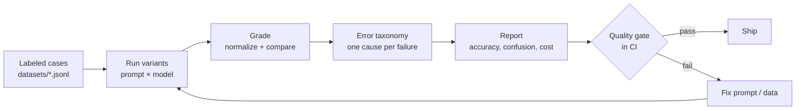

# business-ai-evals

[](https://github.com/yahayuta/business-ai-evals/actions/workflows/ci.yml)

A small, dependency-free harness for **evaluating LLM features used in business
workflows**: score every answer against a labeled dataset, classify *why* it failed,
compare prompt or model variants side by side, and block releases in CI when quality
drops.

The example task is support-ticket triage for an online shop: route each customer
message to a category, extract the order ID, and read the sentiment.

## Why

A demo that "looks right" is easy to build. Keeping an AI feature trustworthy once
people rely on it is harder:

- Is the new prompt actually better, or just better on the three examples I tried?
- When it is wrong, is it a format problem, a routing problem, or an invented value?
- Will someone notice when a model update makes it worse?

This repository answers those questions with a repeatable loop:



## What the report shows

The full output for the bundled example is in
[`reports/sample_report.md`](reports/sample_report.md). An excerpt:

| Variant | Accuracy | Valid JSON | category | order_id | sentiment |
|---|---|---|---|---|---|
| `baseline` | **57.5%** | 92.5% | 82.5% | 75.0% | 75.0% |
| `few_shot` | **65.0%** | 95.0% | 82.5% | 85.0% | 85.0% |
| `few_shot_schema` | **97.5%** | 100.0% | 97.5% | 100.0% | 100.0% |

| Error type | `baseline` | `few_shot` | `few_shot_schema` |
|---|---|---|---|
| invalid_json | 3 | 2 | 0 |
| missing_field | 1 | 0 | 0 |
| wrong_category | 4 | 5 | 1 |
| wrong_order_id | 6 | 3 | 0 |
| wrong_sentiment | 3 | 4 | 0 |

It also breaks accuracy down by case tag (`ambiguous`, `id_format`, `no_id`), shows a
category confusion matrix, lists every failed case with the raw output, and reports
latency, token usage and estimated cost per variant.

> **Note on the bundled numbers.** The recorded responses in CI are *simulated* by
> [`scripts/simulate_runs.py`](scripts/simulate_runs.py) so the whole pipeline runs
> without an API key. They reproduce typical failure patterns (prose around JSON,
> invented order IDs, confusion on ambiguous requests) but are not measurements of a
> real model. Switch a variant to a live provider to measure your own.

## How grading works

1. **Parse** the response as a JSON object, tolerating markdown fences and extra prose.
2. **Normalize** before comparing: labels are case-insensitive, and order IDs written
   as `#10234`, `order 10234` or `ord-10234` all become `ORD-10234`.
3. **Pass** only if every expected field matches.
4. **Classify** each failure with exactly one cause, in this order of precedence:

| Error type | Meaning | Typical fix |
|---|---|---|
| `invalid_json` | Output is not a JSON object | Ask for JSON only, use JSON mode |
| `missing_field` | A required key is absent | Show the full schema |
| `invalid_label` | Category outside the allowed list | List labels explicitly |
| `wrong_category` | Valid label, wrong routing | Decision rules for confusable cases |
| `wrong_order_id` | Missed, invented or mis-read ID | "Use null, never invent one" |
| `wrong_sentiment` | Sentiment mismatch | Define what counts as negative |

One cause per failure keeps the counts additive, so the report tells you which fix
removes the most errors.

## Quality gate

`evals.toml` defines the release variant and its minimum scores:

```toml
[gate]
variant = "few_shot_schema"
min_accuracy = 0.85
min_json_valid = 1.0
min_field_accuracy = { order_id = 0.95 }
```

`python -m evalkit check` exits with status 1 when any threshold is missed, so a
prompt change that hurts quality fails the pull request. CI also publishes the full
report to the job summary and uploads it as an artifact.

## Run it

Requires Python 3.11+. No third-party packages are needed to run evals.

```bash
git clone https://github.com/yahayuta/business-ai-evals.git
cd business-ai-evals
python scripts/simulate_runs.py          # create recorded responses
python -m evalkit run                    # writes reports/report.md, summary.json, results.jsonl
python -m evalkit check                  # quality gate
pip install pytest ruff && pytest -q     # tests
```

### Evaluate a real model

Add a variant with a live provider and set the API key:

```toml
[[variants]]
name = "few_shot_schema-live"
prompt = "prompts/few_shot_schema.txt"
provider = "anthropic"        # or "openai"
model = "your-model-id"
price = { input_per_mtok = 0.0, output_per_mtok = 0.0 }
```

```bash
export ANTHROPIC_API_KEY=...   # or OPENAI_API_KEY
python -m evalkit run --variant few_shot_schema-live
```

### Use your own task

1. Write cases as JSON Lines: `{"id", "input", "expected": {...}, "tags": [...]}`.
2. Write one prompt per variant with an `{input}` placeholder.
3. List labels, variants and gate thresholds in `evals.toml`.

Tags are free text. Use them for the slices you care about (edge cases, customer
segments, languages) and the report will show accuracy for each one.

## Repository layout

```
evalkit/            the harness (dataset, providers, graders, runner, report, CLI)
datasets/           labeled cases (40 synthetic support tickets)
prompts/            three prompt strategies being compared
scripts/            simulated recorded responses for CI
reports/            sample_report.md (generated reports are git-ignored)
tests/              unit tests for grading and an end-to-end test of run + gate
```

## Design choices

- **Standard library only.** HTTP calls use `urllib`, config uses `tomllib`. Nothing
  to install or patch, and it runs anywhere Python runs.
- **Replay provider.** Recorded responses make evals deterministic and free, so they
  can run on every pull request. Live runs are a config change, not a code change.
- **Deterministic grading first.** Exact, normalized comparison is cheap, explainable
  and stable. An LLM judge can be added for open-ended outputs, but it should itself
  be evaluated before it gates anything.

## Roadmap

- LLM-as-judge grader for free-text answers, with agreement checks against human labels
- Repeated runs to measure variance at temperature > 0
- HTML report with filtering

## License

MIT
